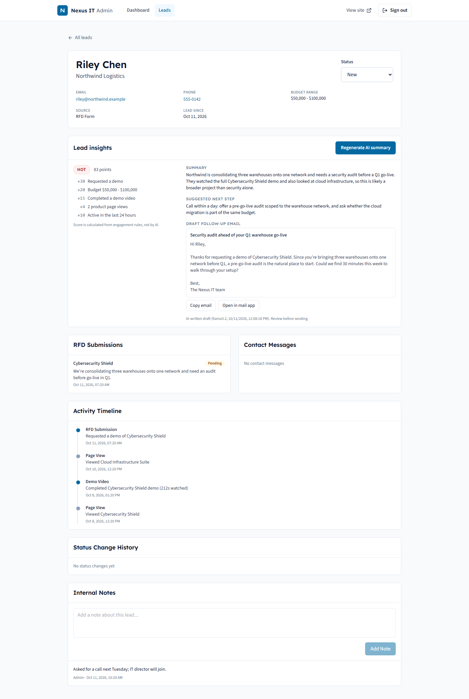
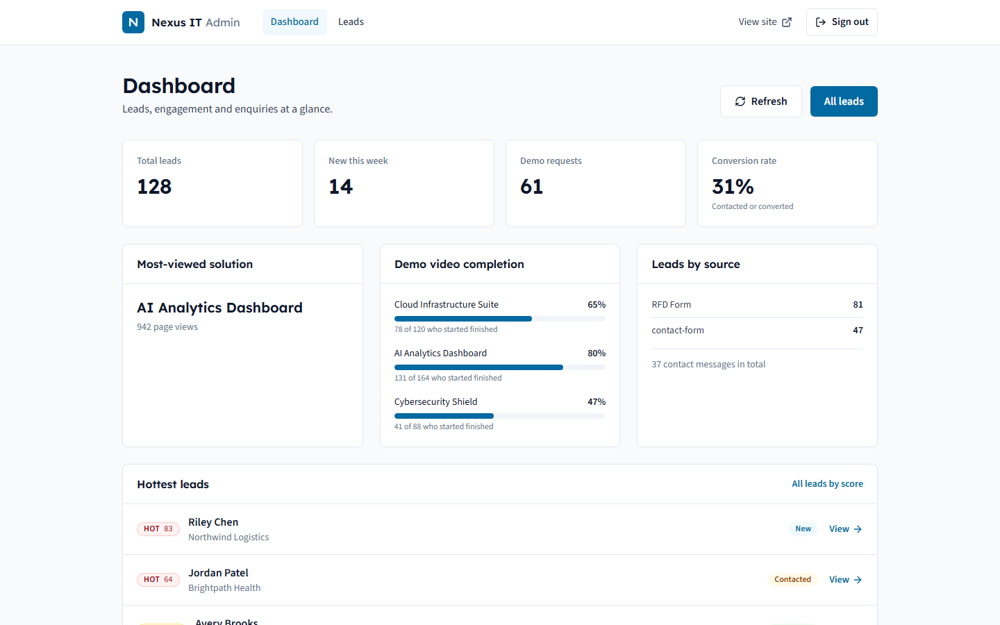
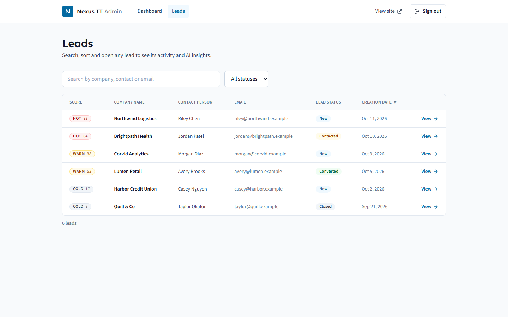
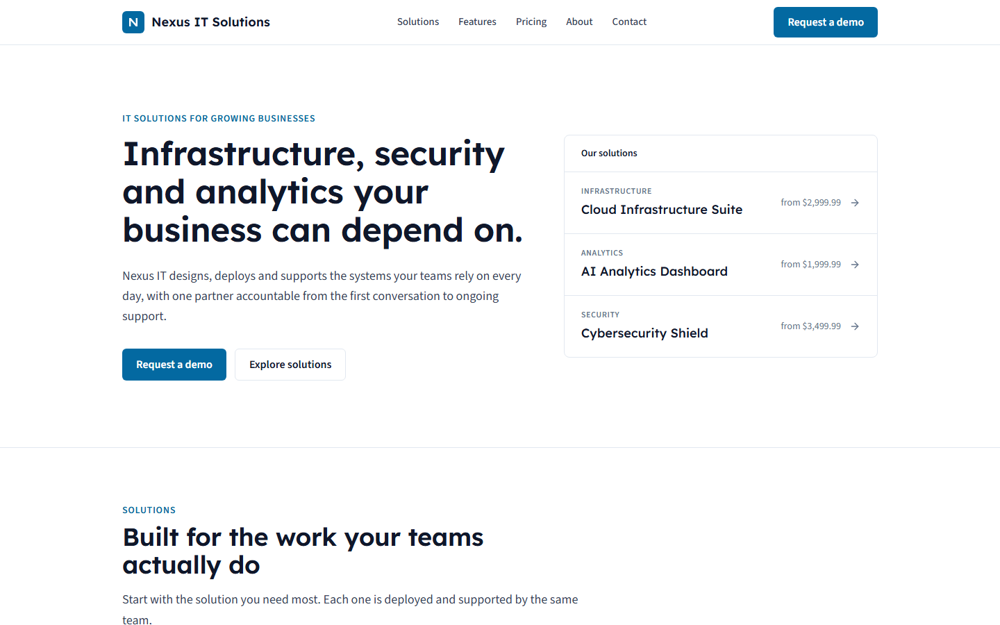
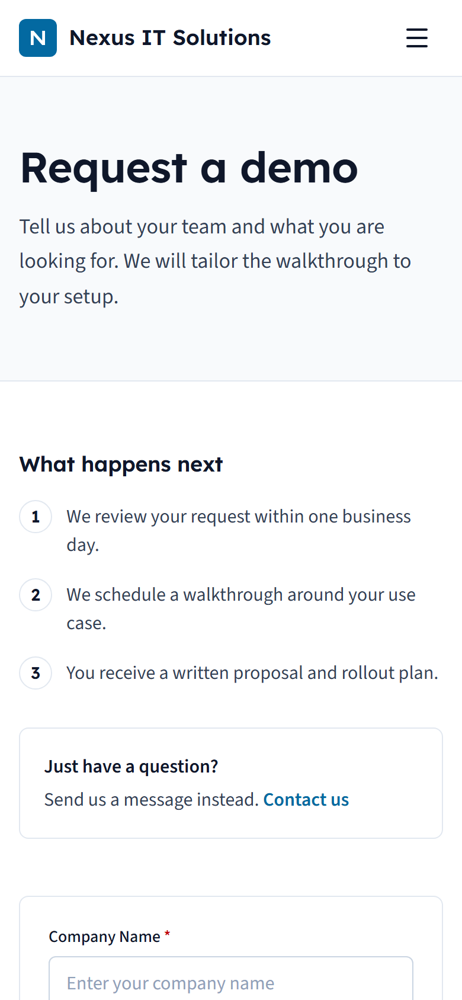
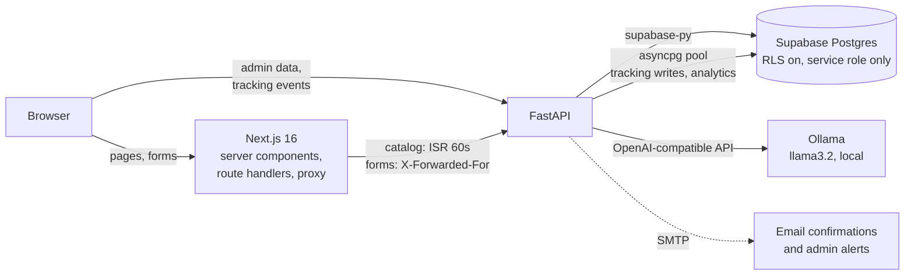

# Nexus IT Solutions Portal

A B2B marketing site and lead-management system for an IT services company. Visitors browse solutions, watch demos and request a walkthrough. Behind the scenes the app tracks how each visitor engaged before they converted, and the sales team works those leads from an admin dashboard. **Each lead gets a transparent score and an AI-written summary and follow-up email, generated by a model running locally**, so lead data never leaves the machine.

**Stack:** Next.js 16 (App Router), React 19, Tailwind CSS v4 · FastAPI · Supabase Postgres · Ollama (local LLM) · Playwright, pytest · GitHub Actions · Docker



<sub>Screenshots use fictional demo data.</sub>

---

## What it does

**For visitors (public site)**
- Marketing site: landing, solutions, features, pricing, about, contact and legal pages. Every page is server-rendered with metadata, a sitemap and `robots.txt`.
- Demo-request and contact forms with inline validation, a honeypot field and per-IP rate limiting.
- Anonymous engagement tracking: product page views and demo-video starts and completions are recorded against a visitor cookie. They're linked to the lead once the visitor fills in a form.

**For the sales team (admin)**
- Dashboard: lead counts, conversion rate, leads by source, the most-viewed solution, demo-video completion per product, and the **hottest leads**.
- Leads table with search, status filter, sorting and a score column.
- Lead profile: the full timeline from first anonymous visit to submission, notes, status changes with an audit trail, and **lead insights**.

| Dashboard | Leads by score |
|---|---|
|  |  |

| Landing page | Mobile |
|---|---|
|  |  |

## AI lead insights: the interesting part

The obvious way to build this is to hand the LLM a lead and ask it to score it. I didn't, for three reasons ([ADR 0002](docs/adr/0002-rules-based-lead-score-with-local-llm.md)):

1. **The score is rules-based, not AI.** Points come from signals that are easy to explain:
   - a demo request (+30) or contact form (+15);
   - budget (+3 to +25);
   - product page views (+2 each, up to +10);
   - demo video completed (+15) or started (+5);
   - recent activity (+10 or +5).

   Sales can see *why* a lead is hot, the ranking is deterministic and testable, and scoring every lead takes 5 queries, not N LLM calls.
2. **The LLM only writes.** Given the facts behind the score, it writes a summary, a suggested next step and a draft email. Its output is constrained to a JSON schema, validated with Pydantic and cached in a `lead_insights` table. The cached text is reused until the lead's data changes; then it's flagged stale and an admin can regenerate it.
3. **It runs locally.** The model is Ollama with `llama3.2`, called through its OpenAI-compatible API. The facts sent to it leave out the lead's email and phone number. Because the client only speaks the OpenAI API, switching to a hosted model is a config change (`AI_BASE_URL`, `AI_MODEL`, `AI_API_KEY`), not a code change.

If the model is unavailable, the score still works and the panel says so instead of failing.

## Architecture



- **Auth:** admin sessions are HS256 JWTs in an httpOnly cookie, signed by Next.js and verified by both Next (`proxy.ts`) and FastAPI with a shared secret. Sessions expire after 15 minutes of inactivity, with a sliding window. Passwords use bcrypt.
- **Two database paths:** high-volume tracking writes and analytics aggregates go through a direct `asyncpg` pool; everything else goes through the Supabase client ([ADR 0001](docs/adr/0001-direct-postgres-for-tracking-writes.md)).
- **Caching:** the public catalog is statically generated and revalidated every 60 seconds; admin data is never cached.

## Engineering

| Area | What's in place |
|---|---|
| **Backend tests** | 84 pytest tests, **90% coverage**, gated in CI at 85%. The in-memory Supabase and asyncpg fakes actually filter and sort, so route logic is exercised for real. |
| **End-to-end tests** | 23 Playwright tests against a production build. Hermetic: the backend URL points at a dead port and the browser's API calls are mocked. Covers form payloads, validation, mobile layout, the admin session redirect and forged-session rejection. |
| **CI** | GitHub Actions jobs: lint, typecheck and build · backend tests with coverage · e2e · Docker image build · `npm audit` and `pip-audit`. Dependabot keeps dependencies current. |
| **Security** | Row-level security on every table · rate limiting (`X-Forwarded-For` trusted only from known proxies) · honeypots · CSP, `frame-ancestors 'none'` and `nosniff` headers · HTTPS redirect · search input sanitized before PostgREST filters · errors never return database details. |
| **Performance and accessibility** | Lighthouse on mobile (production build): **96 to 98 performance, 100 best practices, 100 SEO**, CLS 0 on every page. Accessibility measured 96; the one failing audit (footer contrast) has been fixed. |
| **Local setup** | `docker compose up --build`; add `--profile ai` to include Ollama. |

<details>
<summary>Lighthouse by page (mobile, throttled)</summary>

| Page | Performance | Accessibility* | Best practices | SEO | LCP | CLS |
|---|---|---|---|---|---|---|
| Home | 97 | 96 | 100 | 100 | 2.5 s | 0 |
| Solutions | 96 | 96 | 100 | 100 | 2.8 s | 0 |
| Pricing | 97 | 96 | 100 | 100 | 2.5 s | 0 |
| Features | 97 | 96 | 100 | 100 | 2.5 s | 0 |
| About | 97 | 96 | 100 | 100 | 2.5 s | 0 |
| Contact | 97 | 96 | 100 | 100 | 2.5 s | 0 |
| Demo request | 98 | 96 | 100 | 100 | 2.5 s | 0 |

\*Measured before the footer contrast fix (3.74:1, now 6.8:1), which was the only failing accessibility audit.
</details>

### Bugs worth mentioning
- **Production pages cached with no products.** Public catalog fetches read the session cookie. During prerendering that throws Next's dynamic-render signal, and the code swallowed it and returned an empty list. So the home, solutions and pricing pages and the sitemap were baked in empty and never revalidated. Dev mode hid it; containerizing the app exposed it.
- **A committed secret.** A database credential had been committed to the repository. It was removed and the password was rotated.

## Run it locally

```bash
cp .env.example .env      # Supabase URL and key, DATABASE_URL, SESSION_SECRET
docker compose up --build # http://localhost:3000, API on :8000
```

You'll need a Supabase project with the schema in `supabase/migrations` applied, and an admin account (`python scripts/create_admin.py`). The full guide, without Docker, plus troubleshooting, is in **[docs/setup/LOCAL_DEVELOPMENT.md](docs/setup/LOCAL_DEVELOPMENT.md)**.

```bash
python -m pytest tests --cov=app   # backend tests
npm run test:e2e                   # browser tests
```

## Background and contributions

This started as a team project for **SOFT210 Software Engineering** (Gannon University, Spring 2026, Team B). I designed and built most of it: the full-stack architecture, the FastAPI backend, the admin dashboard, the database schema, visitor tracking and the email notifications.

After the course I kept developing it on my own. That work covers the security hardening, the redesign of the public site and admin, the AI lead insights, the test suites, CI, and Docker. It was built with an AI coding assistant (Claude Code): I set the direction and made the decisions, and every change went through an issue, a pull request and CI. The history is in the [closed pull requests](https://github.com/AvishManiar21/nexus-it-portal/pulls?q=is%3Apr+is%3Aclosed).

## License

[MIT](LICENSE)
